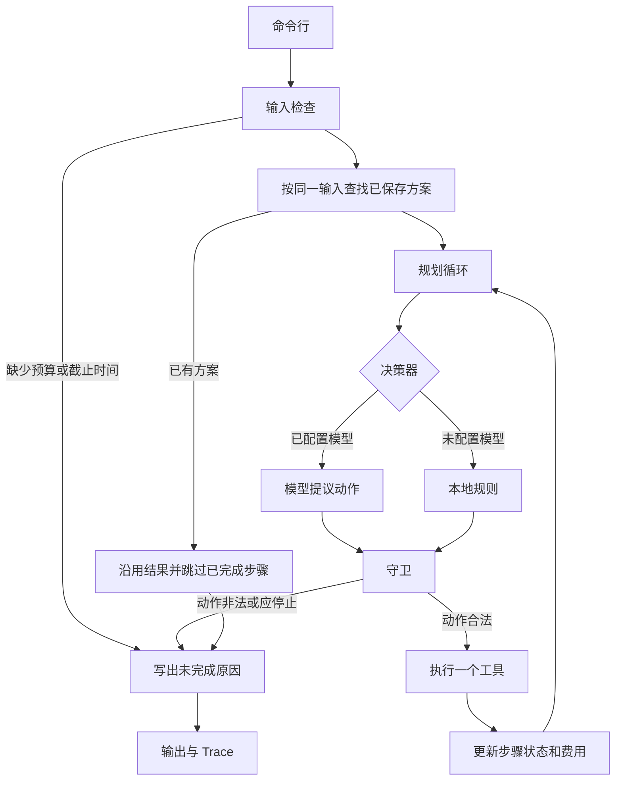
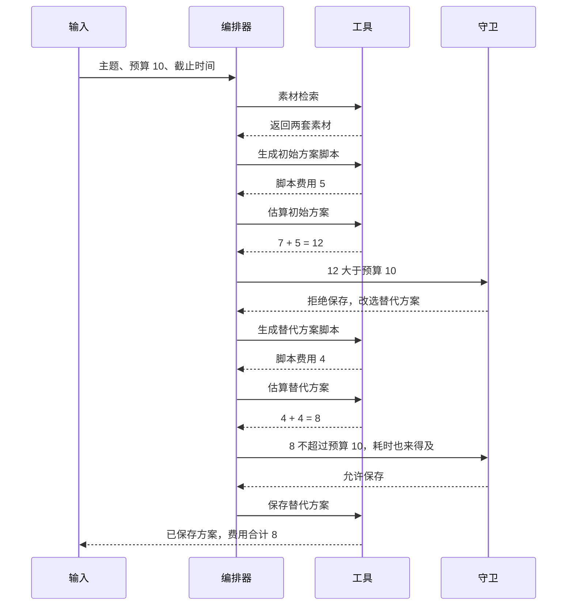

# PRD：内容任务规划 Agent

规划文档。模块拆分、本地规则、守卫和可选模型客户端已经按本文实现。`python -m src.agent acceptance` 仍用本地规则，Trace 的 `decision_source` 为 `local_policy`。在线模型调用需要配置密钥；当前保存的模型循环记录是脚本化决策器，位于 `examples/model_runs/guard_reject_12/`。

## 1. 背景

运营人员要在预算和截止时间内交出一份内容活动方案。输入只有主题、预算、截止时间，以及预先准备的合成素材、费用和耗时。系统需要自己检索素材、生成脚本、估算成本并保存方案。

费用和耗时要等工具返回后才知道。初始方案可能超预算，工具也可能失败或只返回一部分结果。规划不能事先写死一条成功路径，必须根据工具的真实返回继续、改选、停止，并留下已经成功的结果。

参考实例：预算 10 个模拟单位；初始方案估算 12，替代方案估算 8。观察到超预算后改选 8 的方案，再估算、再保存。没有可行方案时返回未完成和缺口。失败步骤不能记为成功。

## 2. 用户与目标

| 角色 | 目标 |
| --- | --- |
| 运营人员 | 给出主题、预算、截止时间，得到一份能落地的方案，或一句说得清的未完成原因 |
| 评审者 | 用命令重复跑通验收场景，并在 `examples/` 里核对输入、输出和 Trace |

成功时，一次运行同时给出：

- 任务计划，覆盖素材检索、脚本生成、成本估算、方案保存
- 每一步的状态和工具返回
- 费用合计，不超过预算
- 计划耗时，不超过截止时间
- 已保存方案

无法完成时，给出未完成原因和缺口，费用合计记 0，已成功步骤的结果仍在输出里。系统不补造用户没有提供的预算或截止时间。

## 3. 范围

### 3.1 要做

- 命令行完成一次规划，并把输入、输出、Trace 写入 `examples/`
- 四个工具：素材检索、脚本生成、成本估算、方案保存
- 动态决策：超预算、超时、工具失败、部分成功、重复执行
- 硬约束：超预算不保存，失败步骤保持 failed，重复执行不重复计费
- 无模型密钥时，用本地规则完成全部必须验收，结果可重复
- 有模型密钥时，模型在同一套工具和守卫上提议下一步

### 3.2 不做

- Web 界面、账号、权限、多人协作
- 真实支付、投放平台、素材版权审核
- 数据库和自训模型
- 把通用 Agent 框架再实现一遍

失败步骤续跑是加分项，不进入必须验收。

## 4. 技术栈

| 层 | 选择 | 承担的职责 |
| --- | --- | --- |
| 语言 | Python 3.10+ | 编排、工具、测试 |
| 运行入口 | `python -m src.agent` | 验收、单次规划、按场景文件运行 |
| 依赖 | 标准库 | JSON、命令行、HTTP、单元测试。必须验收不安装第三方包 |
| 模型协议 | OpenAI 兼容 Chat Completions，`tools` / function calling | 有密钥时，模型只返回下一步动作 |
| 配置 | `.env` 中的 `MODEL_API_KEY`、`MODEL_BASE_URL`、`MODEL_NAME` | 三个变量都为空时不调用外部模型。`.env.example` 写明本地验收无需配置 |
| 数据 | `data/` 下的 JSON | 合成素材、方案费用、耗时、规则 |
| 记录 | `examples/<场景>/` 的 JSON | 输入、实际输出、Trace、已保存方案 |
| 测试 | `unittest` | 对照参考实例和五条必须验收 |
| 框架 | 不使用 LangChain、LangGraph 或其他 Agent 框架 | 决策循环留在本项目代码和 Trace 中，便于核对每一次改选或停止 |

取舍：

- 用命令行和 JSON，是因为评审看的是运行结果和 Trace，不是页面。
- 费用数字放在 `data/`，模型不能在对话里改价。参考实例的 12 和 8 来自工具返回，不写死在分支里。
- 标准库完成 HTTP 和测试，避免验收环境再装一套框架。
- 模型只提议动作。保存、计费和步骤状态由守卫写回。这样既保留动态决策，又守住「超预算不能保存」和「失败不能记成成功」。

## 5. 架构

目标结构如下。对外命令仍是 `python -m src.agent`。

```text
src/agent/
  __main__.py        命令行：acceptance、run
  orchestrator.py    观察 → 决策 → 守卫 → 工具 → 写回状态
  graph.py           步骤依赖，以及失败或超预算后挑选仍可执行的方案
  policy.py          无密钥时的本地规则 R1–R7
  model.py           有密钥时把状态送给模型，解析动作
  tools.py           四个工具
  guard.py           硬约束
  state.py           步骤、费用、已保存方案
  disk_state.py      按 case_id 把状态写到 data/state
  trace.py           事件序列
```



数据流是单向的：工具结果进入状态，决策器只读状态，守卫决定这个动作能不能执行，Trace 追加每一步的请求、返回和决定。已成功步骤只追加，不因为后面失败被删掉或改成 success。

### 5.1 决策器

两个决策器实现同一动作接口。编排器按是否配置模型选择一个。

| 动作 | 含义 |
| --- | --- |
| `continue` | 对当前方案执行下一个尚未完成的工具 |
| `switch` | 放弃当前方案，改选另一个尚未尝试的方案，并重新估算 |
| `retry` | 对刚刚失败的工具再调用一次 |
| `save` | 请求保存当前方案 |
| `reuse` | 沿用已保存方案 |
| `stop` | 结束运行并给出未完成原因 |

模型输出只包含动作、目标方案和理由。它不直接写步骤状态，也不直接写费用。本地规则在无密钥时按 `data/rules.json` 产生同样的动作，保证验收可重复。

### 5.2 守卫

守卫在工具执行前检查动作，在工具返回后检查状态。

- 缺少预算或截止时间：不再调用四个工具，不编造缺失字段。
- `save` 只有在最近一次成功估算不超过预算、且耗时不超过截止时间时才执行。
- 工具返回 `ok: false` 时，该步骤只能是 `failed`。
- 已成功步骤的结果保留。后续失败不改写它们的状态。
- 同一输入再次执行时，若已有保存方案，本次 `incremental_cost` 为 0，费用合计保持原方案的估算。
- 没有任何方案同时满足预算和截止时间：不保存，返回最低估算、预算和缺口。

模型如果在估算为 12、预算为 10 时提议 `save`，守卫拒绝保存，并要求改选或停止。Trace 同时记下模型提议和守卫决定。

### 5.3 工具

工具只做一件事，并返回结构化结果。费用和耗时读 `data/plans.json`，不接受调用方临时改价。

| 工具 | 输入 | 成功时返回 | 失败时 |
| --- | --- | --- | --- |
| 素材检索 | 主题 | 可用素材列表，可以是空列表或部分素材 | `ok: false`，步骤记 failed |
| 脚本生成 | 主题、已检索素材、方案 | 脚本标题、摘要和表内脚本费用 | 同上 |
| 成本估算 | 方案和已取得的素材、脚本 | 素材费、脚本费、估算、是否在预算和截止时间内 | 同上 |
| 方案保存 | 已通过守卫的方案 | 已保存方案 | 保存失败则方案视为未保存 |

费用口径：方案估算等于所采用素材费用加脚本费用。12 = 7 + 5，8 = 4 + 4。工具调用本身不再另加一笔，避免把被放弃的 12 和最终的 8 加在一起。未保存时费用合计为 0；缺口单独写在 `gap` 里。

耗时口径：用输入里的 `as_of` 到截止日 23:59:59 的整小时数，和方案的 `duration_hours` 比较。

### 5.4 状态

步骤状态只有四种：`success`、`failed`、`skipped`、`not_run`。

| 状态 | 含义 |
| --- | --- |
| `success` | 工具返回 `ok: true` |
| `failed` | 工具返回错误。不能再改成 success |
| `skipped` | 重复执行时发现这一步已经成功，本次不调用工具 |
| `not_run` | 因缺信息、无素材或提前停止，工具没有被调用 |

运行结果：

- `completed: true`：有已保存方案，费用合计等于该方案估算，且不超过预算
- `completed: false`：`saved_plan` 为空，并有未完成原因

同一输入的键是主题、预算、截止时间和 `plan_set`。保存成功后写入这个键，供同一次进程里的重复执行识别。

命令行本地运行还会把这份状态写到 `data/state/<case_id>.json`。键是 `case_id`，因为 `over_budget_switch` 和 `repeat` 的主题、预算、截止时间和 `plan_set` 相同，用输入键会互相覆盖。`acceptance` 和单元测试默认不读写这批文件，避免残留状态把下一次验收变成沿用。磁盘上的运行时 JSON 不作为基线。

## 6. 调用流程

无密钥时的默认顺序：

1. 检查预算和截止时间。缺任一项则停止。
2. 查找是否已有同一输入的已保存方案。有则沿用并停止。
3. 检索素材。列表为空则停止，后续工具记 `not_run`。
4. 先按方案列表处理第一个方案，以便参考实例仍然先看到 12。脚本只使用这次检索结果里的素材 id。估算和保存也只计入这些素材。
5. 估算同时满足预算和截止时间：保存并结束。
6. 估算超出限制：在素材都已检索到、且尚未被阻断的方案里，改选目录估算最低的一个，重新生成脚本并再次估算。
7. 全部方案都不可行：停止，缺口等于已经估算过的最低值减预算。
8. 任一工具失败：该步骤记 `failed`，保留此前成功结果。失败只阻断当前方案且还有依赖已满足的方案时，改选其中目录估算最低的一个并重新估算；共享的素材检索失败，或没有这样的方案时，停止保存。

参考实例的具体顺序：



没有可行方案时，初始方案 12、替代方案 15 都会留下成功的估算记录，然后停止。保存步骤为 `not_run`。未完成原因为：最低估算 12，预算 10，缺口 2。

## 7. 功能需求

### 7.1 正常完成

主题、预算、截止时间齐全，工具成功，估算不超过预算且耗时来得及。保存方案。任务计划、步骤状态、工具结果、费用合计、已保存方案五者齐全。

### 7.2 信息或资料不足

- 缺预算或截止时间：不调用会产出方案的保存，原因里点名缺失字段，不补造数字或日期。
- 无可用素材：检索结果为空。检索本身可以是 success，脚本、估算、保存为 `not_run`。

### 7.3 工具失败

素材检索、脚本生成、成本估算或方案保存返回错误时，该步骤为 `failed`。失败前已经成功的工具结果保留。运行未完成时写明失败工具。不把失败调用记成 success，也不把未保存方案记成已保存。

### 7.4 预算或时间超限

估算超过预算，或耗时超过截止时间：

- 还有素材都已检索到的未尝试方案：改选其中目录估算最低的一个，再次估算，通过后再保存。第一个方案仍按列表顺序先试，不靠目录价提前跳过。
- 没有可行方案：不保存，返回未完成、最低估算和缺口。已成功的检索、脚本和估算结果保留。

参考数字固定为预算 10、初始 12、替代 8。无可行方案的对照数字为初始 12、替代 15、缺口 2。三个方案同时存在时，初始 12、高成本 15、低成本 6，超预算后改选 6，不按目录顺序先做 15。见 `examples/choose_feasible/`。

### 7.5 部分成功

检索可以只返回方案所需素材的一部分。状态保留已返回的素材。决策器只基于这部分继续生成和估算；缺到无法形成方案时停止，并说明缺哪类资料。不用空值假装素材已经取全。

### 7.6 重复执行

同一输入再次运行：识别已保存方案，步骤记 `skipped`，`prior_status` 保留上一次的 success。费用合计仍是原估算，本次新增费用为 0。输出说明沿用了哪些步骤。

### 7.7 失败步骤续跑（加分）

从失败步骤继续。此前 success 的步骤不重新调用，费用不重算。续跑后的状态、工具结果和费用合计与 Trace 一致。本项不阻塞必须验收。

同一次进程内的续跑见 `examples/resume_failed/`。另一次命令的续跑读取 `data/state/<case_id>.json`，由 `python -m src.agent run` 在本地规则下写入。验收命令不写这批文件。

## 8. 输入、输出与 Trace

输入至少包含 `theme`、`budget`、`deadline`。场景文件还可包含 `as_of`、`plan_set`、`runs` 和说明用的 `note`。`budget` 为空表示缺预算，不能当成 0。

输出至少包含：

| 字段 | 含义 |
| --- | --- |
| `task_plan` | 任务计划 |
| `step_status` | 步骤状态 |
| `tool_results` | 工具结果 |
| `total_cost` | 费用合计。已保存时等于方案估算，未保存时为 0 |
| `saved_plan` | 已保存方案；未完成时为 null |
| `incomplete_reason` | 未完成原因；完成时为 null |
| `gap` | 费用缺口或缺失字段。没有缺口时为 null |
| `decisions` | 改选、保存、停止或沿用 |
| `failed_steps_marked_success` | 恒为 false |

Trace 的每条事件有序号，类型为 `plan_init`、`tool` 或 `decision`。工具事件带请求和返回。决策事件带规则编号或模型动作、理由、观察到的估算和预算。`decision_source` 在本地规则时为 `local_policy`，模型提议被守卫采纳或拒绝时写明 `model` 与守卫结果。

## 9. 验收

必须通过下面五类。判定看命令输出、`examples/` 里的 Trace 和 `python -m unittest discover -s tests -v`。

| 场景 | 通过标准 | 现有实例 |
| --- | --- | --- |
| 正常完成 | 方案已保存，费用不超过预算 | `examples/normal/` |
| 缺预算或截止时间 | 不保存，原因指出缺失字段 | `examples/missing_info/` |
| 工具失败 | 失败步骤为 failed，已成功结果还在 | `examples/tool_failure/` |
| 预算超限 | 改选后保存 8，或无法可行时返回缺口且不保存 | `examples/over_budget_switch/`、`examples/no_feasible/` |
| 重复执行 | 第二次不新增费用，不丢失第一次的成功结果 | `examples/repeat/` |

资料不足由 `examples/insufficient_materials/` 覆盖。同一实例可以对应多个验收点。

`python -m src.agent acceptance` 重新生成本地规则下的实例。模型模式下的运行另存，不覆盖这些基线，以免密钥或模型波动改写已核对的结果。

## 10. 非功能需求

- 无密钥时，同一输入多次运行，输出和 Trace 一致。
- 参考实例的估算顺序在 Trace 里可见：先出现 12，再出现改选，再出现 8，然后才是保存。
- 中文输出使用 UTF-8。
- 错误写在对应步骤和未完成原因里，进程仍写出 output 与 Trace。
- 模型超时或返回无法解析的动作时，按工具失败处理：不保存，不把该决策记成成功步骤。

## 11. 里程碑

| 阶段 | 内容 | 状态 |
| --- | --- | --- |
| M0 | 本地规则、参考实例 12 改 8、无可行方案缺口、七组实例和单元测试 | 已完成 |
| M1 | 按第 5 节拆分编排器、工具、守卫、状态和 Trace，命令与实例结果保持不变 | 已完成 |
| M2 | 接入可选模型。守卫继续拒绝超预算保存和失败记成功。模型 Trace 单独存放 | 客户端和守卫已完成；在线 Trace 待配置密钥 |
| M3 | 补部分成功实例；失败步骤续跑 | 已完成，见 `examples/partial_materials/` 与 `examples/resume_failed/` |
| M4 | 按实际运行撰写 `docs/01` 至 `docs/05` | 已完成 |

## 12. 已知限制

- 还没有模型在线观察到 12 之后再改选的 Trace。`examples/model_runs/guard_reject_12/` 是脚本化决策器走过模型循环的结果。
- 工具费用已经含在方案估算里，没有单独的工具调用价目表。
- 方案目录是按 `plan_set` 取合成数据，不是开放域检索。
- 本地规则路径为了保持基线 Trace，不会在每个工具前写一条 `continue`。模型路径会记录每一次提议和守卫决定。两条路径共用 `graph.py`：脚本素材来自检索结果；方案级工具失败后，若还有依赖已满足的方案，模型循环把选择交回决策器，守卫拒绝在失败步骤上继续 `continue`。
- 本地规则会在失败或超预算后直接改选。模型循环不代为改选，避免脚本化动作序列和自动改选错位。
- 后续若改行为，先改本文，再改代码和 `docs/03-evaluation.md`。
