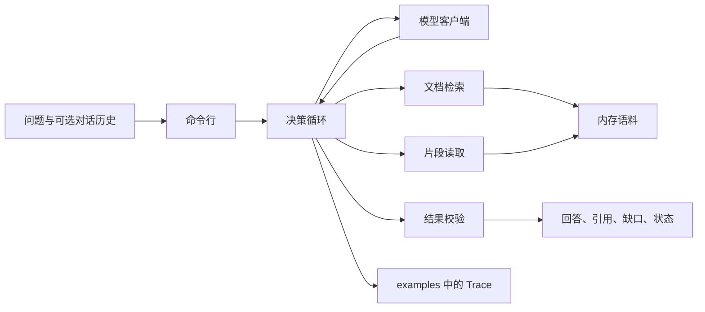

# 企业知识问答 Agent PRD

本文确定第一版的技术栈、架构和实现边界。产品行为以 [docs/01-requirements.md](docs/01-requirements.md) 为准；资料规则以 `data/README.md` 为准。实现在 `src/knowledge_agent/`。

## 1. 要解决的问题

员工询问制度或产品问题时，系统只根据给定资料作答，并交出四项结果：回答、引用、资料缺口、任务状态。引用中的原文片段必须来自本轮工具返回的连续原文。

资料互相冲突且正文没有适用范围或效力优先级时，系统并列引用并请求确认适用文档，不选其中一个答案。只检索到一份相关文档时，按该文档作答。

## 2. 用户与范围

**用户：** 查询制度或产品说明的内部员工。

**第一版包含：**

- 单轮问题和带对话历史的追问。
- 两类工具：文档检索、片段读取。
- 模型按已有证据选择补充检索、读取原文、追问或停止。
- 命令行运行一次问答，并把 Trace 写到 `examples/`。
- 六类验收场景，以及 FaithEval inconsistent 上的冲突题和只检索到 D01 的题。

**第一版不包含：**

- 网页界面、账号权限、审批流和办公软件接入。
- 员工上传临时文件。
- 用模型自身知识补写资料里没有的制度或产品事实。
- 向量数据库、多租户和在线增量更新语料。
- 把 FaithEval 段落改写成报销制度。

## 3. 成功标准

| 场景 | 通过条件 |
| --- | --- |
| 明确答案 | 状态 `answered`；结论与原文一致；引用含文档 ID、版本日期和可逐字核对的片段；缺口为空。 |
| 文档冲突 | 状态 `conflict`；双方文档都被引用；指出冲突句子；不把其中一个答案当成唯一结论；请求确认适用文档；缺口写明缺少效力规则。 |
| 资料外问题 | 状态 `insufficient_evidence`；不编造；引用为空；缺口说明缺哪一类资料。 |
| 改写后的相似问题 | 与原问使用同一文档 ID、同一版本日期和同一事实结论。 |
| 上下文追问 | 继承上一轮对象和限定；引用对应该限定下的原文。 |
| 工具失败 | 状态 `tool_failure`；把核实失败和“库里没有资料”分开；已读到的证据仍可引用。 |

FaithEval 额外条件：

- 冲突题同时引用 D01 和 D02，`forbidden_sole_answers` 中的两个答案都不能单独成为结论。
- 只检索到 D01 的题按 D01 的 `supported_answer` 作答，并只引用 D01。
- `answer_in_body` 为 false 时，引用摘自 `body`，不把对不齐的答案字符串写成原文片段。

决策也要可检查：证据已经足够时不再继续调用工具；摘要不完整或可能冲突时先读取原文，再给最终状态。

## 4. 技术栈

运行时定为 **Python 3.12**。资料准备脚本已经使用这个版本。第一版不引入 Node。

| 层 | 选择 | 原因 |
| --- | --- | --- |
| 语言与包管理 | Python 3.12，`requirements.txt` | 与现有 `prepare.py` 一致，测试和语料脚本可以共用。 |
| Agent 循环 | 自写循环，不使用 LangChain、LlamaIndex 或其他 Agent 框架 | 动作只有检索、读取、追问、停止。循环本身要出现在 Trace 里，测试还要注入工具失败。 |
| 模型接入 | OpenAI Chat Completions 兼容接口 | 一个客户端可以指向不同供应商。模型只返回 JSON 动作，不直接接触文件系统。 |
| 数据结构 | Pydantic 2 | 约束工具参数、最终结果和 Trace。 |
| 检索 | 一次 `search` 内部做三路词法召回，再用倒数排名融合和重排 | 词法三路可重复运行。融合提高召回，重排提高前 5 条的精度，并保留分数接近的冲突文档。 |
| 语料存储 | 启动时把 JSONL 载入内存 | 当前资料已经是 `documents.jsonl`。第一版没有并发写入。 |
| 测试 | pytest | 覆盖六类场景和 FaithEval 抽样。脚本模型测试不访问网络。 |
| 命令行 | 标准库 `argparse` | 只需要一次问答和评测两个入口。 |

运行期依赖保持在这四项：`pydantic`、`openai`、`rank-bm25`、`pytest`。短语匹配、字符 n-gram 和融合重排用标准库实现。`pandas` 和 `pyarrow` 只留给资料准备脚本，问答运行不依赖它们。

## 5. 架构



职责分开：

- **语料库**负责按文档 ID 保存正文、版本日期、文档类型、适用范围和优先级。它不做判断。
- **工具**把检索和读取的结果原样返回。检索片段只表示可能相关。
- **模型**只看到工具返回的文本和对话历史，并决定下一步。
- **循环**执行模型选定的动作，限制轮数，并记录 Trace。
- **校验**检查引用是不是本轮工具结果里的连续原文，以及状态和缺口是否匹配。校验不改写事实，也不替模型挑选冲突中的一方。

### 5.1 计划中的代码边界

实现时按下面的边界放进 `src/knowledge_agent/`：

| 模块 | 职责 |
| --- | --- |
| `corpus.py` | 读取 JSONL，建立文档 ID 索引、BM25 索引、短语索引和字符 n-gram 索引。 |
| `tools.py` | 实现多重检索、片段读取，以及可注入的失败。 |
| `schema.py` | 定义动作、引用、最终结果和 Trace。 |
| `model.py` | 调用兼容接口；测试时换成按剧本返回动作的模型。 |
| `loop.py` | 执行动态决策，直到停止或达到轮数上限。 |
| `guard.py` | 核对引用原文、状态和缺口。 |
| `cli.py` | 单次问答入口。 |

`tests/` 放可执行验收。`examples/` 只放输入、实际输出和 Trace，不放语料。

## 6. 数据与工具

### 6.1 文档

沿用现有字段，并允许两类来源共用同一结构：

| 字段 | 要求 |
| --- | --- |
| `doc_id` | 稳定且唯一。 |
| `version_date` | 有则保留。FaithEval 文档为空，空值不能当成更新或优先级。 |
| `doc_type` | `faq`、`policy` 或 `passage`。 |
| `body` | 可检索、可按片段读取的正文。 |
| `scope` / `priority` | 正文之外的显式范围或优先级。空表示文档没有给出。 |

六类验收场景使用单独的小型制度语料，后续放在 `data/policies/`。FaithEval 继续使用 `data/faitheval-inconsistent/documents.jsonl`。两个语料不混在同一次检索里。

### 6.2 检索工具

输入是检索语句。语句由当前问题，以及从对话历史里还原出的对象和限定组成。模型看到的仍是一次 `search`。补充检索继续由模型决定，用来换一个查询；多重检索负责把这一次查询的候选找准。

工具内部依次完成三路召回、融合和重排：

| 路 | 找什么 | 作用 |
| --- | --- | --- |
| BM25 | 分词后的词项重叠 | 处理正常用词和同主题文档。 |
| 短语匹配 | 数字、专名和连续词组，例如 “30 天” 或 “£1.3bn” | 把真正写到该事实的文档排到主题相近但事实不同的文档前面。 |
| 字符 n-gram | 大小写和标点规范化后的字符片段 | 题面有错字时仍能召回对应正文。 |

三路各自取出最多 20 条，用倒数排名融合（RRF，常数 k=60）合并。融合后保留前 20 条，再按查询词覆盖率、短语命中和数字是否一致重排，最后返回最多 5 条。

重排要保留冲突文档。融合分数接近的文档一并留下，不能只返回分数最高的一份。两份文档都写“报销期限”但天数不同时，两份都应出现在前 5 条；只留下高分的一份，会把冲突误答成明确答案。

每条候选包含文档 ID、版本日期、文档类型、相关片段、片段是否完整，以及命中了哪几路。相关片段是正文中的连续文字。检索结果不是已经核实的答案。Trace 记录每路的命中文档和最终名次。

### 6.3 读取工具

输入是文档 ID。返回该文档的正文；正文超过 4000 个字符时，返回包含检索命中位置的连续片段，并标明被截断。返回值同时带文档 ID 和版本日期。

文档 ID 不存在时返回“未找到”，这和工具失败不是同一件事。未找到可以支持 `insufficient_evidence`。超时、异常和被测试注入的错误才是工具失败。

### 6.4 工具失败

同一工具在一轮里最多自动重试一次。重试仍失败后停止。状态为 `tool_failure`。回答写明哪个工具失败，以及哪部分因此没有核实。失败之前已经成功读到的证据可以保留在引用里。

## 7. 动态决策

模型每一轮只返回一个 JSON 动作：

| 动作 | 用途 |
| --- | --- |
| `search` | 首次检索，或因为结果偏题、过窄、没有覆盖对话限定而补充检索。 |
| `read` | 片段不完整、只覆盖问题的一部分，或两份文档可能冲突时读取原文。 |
| `ask` | 缺少对象或范围，继续回答会产生不同结论。追问要指出缺的条件。 |
| `finish` | 证据已足够，或继续调用工具也不会改变结论。 |

限制：

- 一轮最多 6 个动作，其中 `finish` 或 `ask` 必须出现。
- 达到上限时，用已经成功取得的证据交付；证据不够则使用 `insufficient_evidence` 或 `tool_failure`，不编造剩余部分。
- 同一个文档在片段已经完整时不重复读取。
- 检索没有候选时，不读取不存在的文档，直接进入资料缺口判断。

`ask` 的交付状态是 `needs_clarification`。`finish` 的状态由证据决定，只能是 `answered`、`conflict`、`insufficient_evidence` 或 `tool_failure`。

冲突规则固定为：

- 两份及以上已读文档对同一要点给出不能同时成立的结论，且 `scope`、`priority` 和正文都没有效力规则时，状态必须是 `conflict`。
- 版本日期只说明哪一版更晚，不能单独决定采用哪一版。
- 只检索到一份相关文档，且读取后没有第二份冲突证据时，按该文档作答，状态为 `answered`。

## 8. 交付与校验

员工可见结果只包含这四部分：

```json
{
  "answer": "先写结论，再写适用条件和例外",
  "citations": [
    {"doc_id": "文档 ID", "version_date": null, "excerpt": "工具返回中的连续原文"}
  ],
  "gaps": [],
  "status": "answered"
}
```

状态为 `conflict` 或 `needs_clarification` 时，`answer` 里要写出需要用户确认的具体条件。资料缺口仍放在 `gaps`。

校验在返回前执行：

- `excerpt` 必须能在本轮对应文档的检索片段或读取结果中逐字找到。
- `version_date` 复制自语料记录，包括空值。
- `answered` 时 `gaps` 为空，且至少有一条引用。
- `insufficient_evidence` 且完全没有相关材料时，引用为空，`gaps` 说明缺少的资料类型。
- `conflict` 时至少引用两份文档，`gaps` 写明缺少的效力规则。
- 校验失败时，把失败原因交回模型修正一次。第二次仍失败，则保留已通过校验的引用，状态改为 `insufficient_evidence`，并在缺口中说明结果未能满足引用约束。校验不另选一个事实答案。

Trace 单独保存，不混进员工可见结果。每个动作记录动作名、参数、工具返回或模型给出的最终 JSON。

## 9. 配置、运行与评测

实现后用下面的方式运行：

```text
python -m knowledge_agent.cli --question "问题" --corpus data/policies
python -m knowledge_agent.evaluate --tasks data/faitheval-inconsistent/tasks.jsonl
```

对话历史用 JSON 文件传入。一次运行把输出和 Trace 写入 `examples/`。

环境变量只在真实调用模型时需要：

| 变量 | 用途 |
| --- | --- |
| `MODEL_BASE_URL` | OpenAI 兼容接口地址。 |
| `MODEL_API_KEY` | 接口密钥。 |
| `MODEL_NAME` | 模型名。 |

密钥只放在本地 `.env`，不写入仓库。`.env.example` 在实现时列出这三个变量名。使用剧本模型的验收测试不读取它们，因此无密钥也可以运行测试。

FaithEval 评测按任务限定检索池，而不是在 3000 份文档里做一次开放检索：

- `document_conflict` 的检索池只有该题的 D01 和 D02。
- `single_document` 的检索池只有 D01。

这样测的是“给定检索结果后如何作答”。开放检索是否总能把成对文档一起找回来，不作为第一版的通过条件。第一版从冲突题和单文档题中各抽 20 题做可重复评测，固定抽样种子并写入评测说明。

六类场景使用 `data/policies/` 里的小型语料，并在对应测试里注入工具失败。相似改写和上下文追问使用同一份语料的不同问法。

## 10. 实现顺序

1. 定下语料加载、两个工具和结果数据结构。
2. 用剧本模型跑通决策循环、引用校验和 Trace。
3. 补齐六类场景的小型语料和 pytest。
4. 接入 FaithEval 的限定检索池评测。
5. 最后接入真实模型，并更新 `README.md` 的安装与运行命令。

第 1 步到第 4 步不需要模型密钥。
