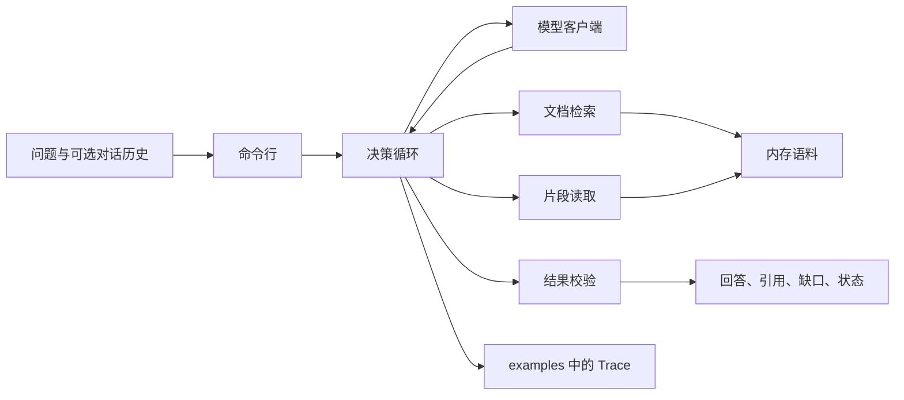

# 方案

本文说明第一版实际怎么调用、怎么做动态决策，以及为什么这样取舍。需求见 [01-requirements.md](01-requirements.md)，模块边界见 [PRD.md](../PRD.md)。

## 1. 调用流程

一次问答从命令行进入。默认模型是剧本模型，不访问网络。`--model openai` 才读取 `.env` 里的 `MODEL_BASE_URL`、`MODEL_API_KEY` 和 `MODEL_NAME`。

职责分开：

| 模块 | 做什么 |
| --- | --- |
| `corpus.py` | 把 JSONL 载入内存，提供文档 ID 索引和三路检索索引。 |
| `tools.py` | 执行一次检索内的三路召回、融合、重排，以及按文档 ID 读取。 |
| `policy.py` | 剧本模型的下一步和最终判断：检索语句、是否读取、冲突、拒绝。 |
| `model.py` | 剧本模型直接调用 `policy.py`。真实模型只返回一个 JSON 动作。 |
| `loop.py` | 执行动作，限制轮数，失败重试一次，记录 Trace。 |
| `guard.py` | 核对引用是不是本轮工具结果里的连续原文，以及状态和缺口是否匹配。 |
| `cli.py` | 单次问答，把结果写到 `examples/last-run.json`。 |

语料库不做判断。工具不改写正文。校验不挑选冲突中的一方，也不另编一个事实。

## 2. 动态决策

一轮最多 6 个动作，其中必须出现 `finish` 或 `ask`。同一工具失败后自动再试一次。第二次仍失败就停止，状态为 `tool_failure`，并写明这是工具没有返回结果，不是资料库里没有内容。同一个文档已经完整读取后不再读第二次。

剧本模型按已有证据选择下一步：

1. 还没有成功检索时，执行 `search`。问题里出现「那、这、呢、它、此」且历史里有上一句用户问题时，把上一句拼进检索语句。
2. 检索没有候选时，停止并返回 `insufficient_evidence`，引用为空。
3. 候选至少两份，或片段不完整，且还没读过时，逐份 `read`。
4. 证据够了就 `finish`。作答前先丢掉没有覆盖所问事实、或适用范围对不上的文档。

`finish` 时的判断：

- 过滤后没有文档：`insufficient_evidence`。
- 两份文档是近义改写且替换段不同，或两份都相关、又没有范围和优先级，且全文不是同一规定：`conflict`。并列引用冲突句，请求确认适用文档。版本日期只附一句「较晚，但不能单独作为采用依据」。
- 全文去掉空白和标点后相同：按该规定作答，状态 `answered`。
- 其余情况选最相关的一份，用其中最贴问题的句子作答。引用保留该次读取的正文，以便答案所在的句子仍在引用里。

中文问题会把问句拆成内容块。某一块在原文里对不上，或文档写明「只适用于」其他对象，这份文档就不算支持。英文问题暂不做这层拒绝，避免把 FaithEval 里的错字问句整题判成无法回答。细节见 [03-evaluation.md](03-evaluation.md)。

真实模型每一轮也只返回一个 JSON 动作：`search`、`read`、`ask` 或 `finish`。系统提示要求：原文没有所问事实或适用范围不符时用 `insufficient_evidence`；两份原文是同一规定时不要判 `conflict`。循环和校验对两种模型相同。

校验失败时，把原因交回模型修正一次。第二次仍失败，保留已通过校验的引用，状态改为 `insufficient_evidence`，缺口写明结果未能满足引用约束。

## 3. 检索

一次 `search` 内部走三路，模型看到的仍是一次检索。补充检索由下一步决定，用来换查询。

| 路 | 找什么 |
| --- | --- |
| BM25 | 中文词和二字组，加上英文词。 |
| 短语 | 数字加单位、金额、至少 4 个字母的英文词、4 到 8 字的连续中文。 |
| 字符 3-gram | 大小写和标点规范化后的字符片段，用来对付错字。 |

三路各自最多 20 条，用倒数排名融合，常数 k=60。融合后保留 20 条，再按词覆盖、短语命中和数字是否一致重排，返回最多 5 条。与最高分相差不超过 0.02，或达到最高分 90% 的文档一并留下，避免冲突的两份制度被收成一份。

检索片段是正文里的窗口，最长 180 字。只有窗口等于全文时，片段才算完整。读取返回命中位置附近的正文，最长 4000 字。

## 4. 技术取舍

**自写循环，不用 LangChain 或 LlamaIndex。** 动作只有检索、读取、追问、停止。循环要出现在 Trace 里，测试还要注入工具失败。框架会把这几步包进自己的调用链。

**词法三路，不用向量数据库。** 第一版语料可以整份放进内存，也没有增量更新。词法召回可以重复运行，不需要额外模型和索引服务。冲突文档靠融合后的接近分数保留，不靠向量距离。开放语料上的改写召回如果以后不够，再加稠密检索，并继续用同一套融合留住分数接近的文档。语料放不进内存或需要增量更新时，才单独引入向量库。

**剧本模型作为默认路径。** 六类场景和 FaithEval 抽样不需要密钥，结论由工具结果和规则决定，不读取数据集里的 `supported_answer` 来作弊。真实模型是可选路径，行为约束写在系统提示和校验里。

**FaithEval 用封闭检索池。** 冲突题只放入该题的 D01 和 D02，单文档题只放入 D01。测的是给定候选后如何作答，不把「3000 份文档里能否一次找回成对文档」当作第一版通过条件。

**不把 FaithEval 改写成报销制度。** 段落来自公开问答集，许可证不能重新打包。制度行为用 `data/policies/` 里的五份合成文档验收。两套语料不在同一次检索里混用。
