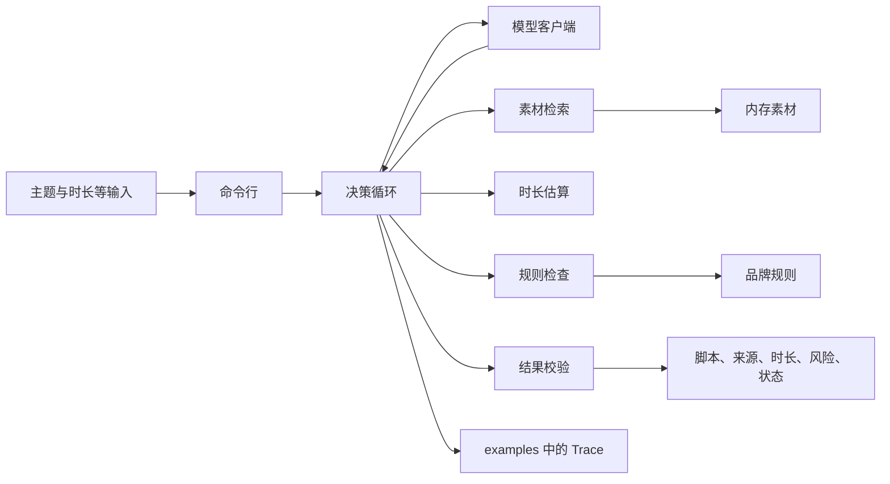

# 短视频脚本 Agent PRD

本文确定第一版的技术栈、架构和实现边界。产品行为以 [docs/01-requirements.md](docs/01-requirements.md) 为准。素材范围和许可以 [data/README.md](data/README.md) 为准。实现放在 `src/script_agent/`。

## 1. 要解决的问题

创作者给出主题和目标时长后，系统交回可逐镜修改的脚本。产品事实只能来自本轮检索到的素材 `body`。预计总时长只能来自时长估算工具。阻断性品牌规则未通过时，状态不能是 `completed`。

参考实例按这个边界实现：素材只有「支持字幕」时，脚本不能写出「效率提升 80%」。目标时长 30 秒、首稿被估成 38 秒时，压缩后再估算；结果为 28 秒时，交付包含分镜、来源 ID 和总时长。38 和 28 由工具算出来，不写进素材。

## 2. 用户与范围

**用户：** 制作一条短视频的创作者。

**第一版包含：**

- 一次生成。输入是主题、受众、平台、目标时长和风格。
- 三个工具：素材检索、时长估算、规则检查。
- 模型在检索为空、时长未过或规则未过时选择下一步。
- 命令行跑一次，并把结果和 Trace 写入 `examples/`。
- 五类验收。验收语料用小型夹具。AdvertiseGen 作为开放素材库，不把广告文案编入索引。

**第一版不包含：**

- 成片、剪辑、配音、上传、排期和投放账户。
- 网页界面、账号权限和在线更新语料。
- 向量数据库、Agent 框架和语音合成。
- 用模型常识补写素材里没有的功能、功效和数字。
- 把 AdvertiseGen 的 `reference_summary` 改写成产品事实或分镜。

## 3. 成功标准

| 场景 | 通过条件 |
| --- | --- |
| 正常生成 | 状态 `completed`。七项交付齐全。来源 ID 来自本轮检索。预计总时长不超过目标。阻断规则通过。素材没有的数字不出现。 |
| 缺关键信息 | 状态 `needs_input`，指出缺少的字段。Trace 中没有检索。 |
| 无素材 | 检索为空。剧本模型改写一次后再检索，仍为空则 `no_material`。来源 ID 为空。真实模型也可以改为 `needs_input`。 |
| 工具失败 | 同一工具失败后自动重试一次。仍失败则 `tool_failure`，写明工具名。与检索为空区分开。 |
| 超时长后修正 | Trace 先有 38.000 秒，再有 28.000 秒。目标 30 秒。状态 `completed`，分镜引用 P01。 |
| 超时长后失败 | 必须保留的声明单独估算已超过目标时长。状态 `unsatisfied`，附草稿和最后一次秒数。 |

`completed` 只在当前草稿已经通过时长估算和规则检查之后使用。短于目标时长时可以完成，风险写「短于目标时长」。

## 4. 技术栈

运行时定为 **Python 3.12**。本机是 3.12.8，`data/advertisegen/prepare.py` 已在这个版本运行。第一版不引入 Node。

| 层 | 选择 | 原因 |
| --- | --- | --- |
| 语言与包管理 | Python 3.12，`requirements.txt` | 与资料脚本同一运行时。测试可以直接调用估算和规则函数。 |
| Agent 循环 | 自写循环 | 动作是检索、写稿、估算、检查、补充或停止。每一步都要进 Trace。测试要注入工具失败和固定稿长。 |
| 模型接入 | OpenAI Chat Completions 兼容接口 | 一个客户端可以换供应商。模型只返回一个 JSON 动作，不读写文件，不自报时长。 |
| 验收模型 | 剧本模型 | 按场景返回固定动作。五类验收不访问网络，也不需要密钥。 |
| 数据结构 | Pydantic 2 | 约束动作、分镜、工具返回、最终结果和 Trace。 |
| 检索 | 内存中的词法检索 | 属性串很短，11 万条可以一次性载入。词法结果可以重复。 |
| 时长与规则 | 纯函数 | 同一稿必须得到同一秒数、同一违规列表。模型不能改写工具给出的秒数。 |
| 语料存储 | JSONL | 已经是 `documents.jsonl`。第一版没有并发写入。 |
| 测试 | pytest | 覆盖五类场景。夹具语料与 AdvertiseGen 分开。 |
| 命令行 | 标准库 `argparse` | 只需要一次生成。 |

运行期依赖四项：`pydantic`、`openai`、`rank-bm25`、`pytest`。分词、时长和规则匹配用标准库。`prepare.py` 不增加依赖。实现开始时把这四项写入 `requirements.txt`。

不使用 LangChain、LlamaIndex、jieba、向量库、ffmpeg 或语音合成。中文按字符二元组检索，不另装分词器。

## 5. 架构



职责分开：

- **语料库**按来源 ID 保存 `body` 和属性。它不判断脚本能不能发，也不读取广告文案。
- **工具**返回检索片段、秒数或违规项。工具不改稿。
- **模型**只看到输入和工具结果，并选择下一个动作。
- **循环**执行动作，限制检索次数和改稿次数，失败时重试一次，并写 Trace。
- **校验**核对来源 ID、引用是否为 `body` 的连续原文、数字是否出现在已引用素材里，以及状态是否和最近一次检查一致。校验不补写卖点，也不改秒数。

### 5.1 代码边界

| 模块 | 职责 |
| --- | --- |
| `corpus.py` | 读取素材 JSONL，拒绝没有 `body` 的记录，建立来源 ID 索引和词法索引。 |
| `rules.py` | 读取品牌规则 JSONL。 |
| `tools.py` | 检索、时长估算、规则检查，以及可注入的失败。 |
| `textutil.py` | 统计可计时字符。时长估算和剧本稿共用这一处。 |
| `schema.py` | 定义动作、分镜、工具结果、最终交付和 Trace。 |
| `model.py` | 兼容接口。测试时改为剧本模型。 |
| `policy.py` | 剧本模型的分场景动作，包括 152 字稿、112 字稿，以及仍超时后的最短事实句。 |
| `loop.py` | 执行动态决策，直到停止或达到次数上限。 |
| `guard.py` | 核对引用、数字、时长和状态。 |
| `cli.py` | 单次生成入口。 |

`tests/` 放可执行验收。`examples/` 只放输入、实际输出和 Trace。

## 6. 数据与工具

### 6.1 两套语料

| 路径 | 用途 |
| --- | --- |
| `data/fixtures/` | 五类验收。实现时新增，体量很小。 |
| `data/advertisegen/documents.jsonl` | 开放素材库，115669 条属性串。 |
| `data/advertisegen/reference_summaries.jsonl` | 广告文案。`citable` 为 false。不进入索引，不参与检索。 |

同一次检索只打开一个素材文件。验收不在 11 万条里碰运气。开放库用来核对「文案里的 100% 不能写进脚本」，例如 `AG-dev-000533` 的 `body` 只有「棉」。

夹具素材至少包括：

```json
{"source_id":"P01","body":"功能#支持字幕","attributes":[{"key":"功能","value":"支持字幕"}]}
```

P01 的可引用事实只有「支持字幕」。

### 6.2 素材检索

输入是查询语句。返回最多 5 条。每条包含来源 ID、完整 `body`、属性和命中的属性值。属性串短于 200 字，片段就是整段 `body`，不截断。

索引做两件事：

- 用 `body` 的汉字二元组做 BM25，处理主题里的自然语句。
- 查询包含某个长度不少于 2 的属性值时，提高该素材的名次。这样「字幕」会命中 P01。

空列表是正常结果。来源 ID 不存在、超时、异常和测试注入的错误才是失败。Trace 记录查询、命中 ID 和空结果。

### 6.3 时长估算

输入是当前分镜、平台和风格。返回各镜毫秒数、总毫秒数，以及换算后的秒。模型草稿里如果自带时长，工具覆盖它。

可计时字符只计汉字、英文字母和数字。空白和标点不计。

| 风格 | 语速 |
| --- | --- |
| 口播，以及未识别风格 | 4 字/秒 |
| 纯字幕 | 3.5 字/秒 |

口播计旁白；旁白为空时改计字幕。纯字幕计字幕；字幕为空时改计旁白。两者都空的镜头为 0 毫秒。平台不改变语速。未填写平台时，风险里说明使用了上述默认语速。

单镜毫秒用整数计算：`round(字符数 × 1000 / 语速)`。总毫秒是各镜毫秒之和。交付的秒等于总毫秒除以 1000，保留三位小数。通过条件是总毫秒小于或等于目标秒数乘以 1000。

因此 4 字/秒时，152 个可计时字符是 38.000 秒，112 个是 28.000 秒。验收用这两个长度复现参考实例，不把 38 或 28 存进素材。

### 6.4 规则检查

输入是标题、分镜和规则集。返回通过，或违规列表。违规项包含规则 ID、位置、说明和是否阻断。

规则放在 JSONL，由工具读取。每条有 `rule_id`、`blocking` 和一种检查：

| 种类 | 行为 |
| --- | --- |
| `forbid_regex` | 标题、旁白或字幕命中正则则为违规。 |
| `require_substring` | 指定句子必须原文出现。缺失则为违规。 |

另外有一条始终生效的事实检查，规则 ID 为 `FACT-NUMBER`：标题、旁白和字幕里的「数字+%」或「数字+倍」，必须在本条已引用素材的 `body` 里原文出现。P01 上写出「效率提升 80%」或「100%」会命中这条。它是阻断项。

未提供规则文件时，品牌规则为空，`FACT-NUMBER` 仍然生效。空规则文件表示没有额外的品牌限制。

明确失败的夹具使用一条阻断规则，要求原文出现：

`本视频仅介绍已列出的功能，具体以产品说明为准。`

去掉标点后是 21 个可计时字符。4 字/秒时为 5.250 秒。验收把目标时长设为 4 秒，保留这句话会超时，删掉它会违反规则。

### 6.5 工具失败

同一次调用失败后自动再试一次。第二次仍失败就停止，状态为 `tool_failure`。结果写明工具名，以及素材、时长或规则中哪一项没有完成。失败前已经检索到的来源 ID 可以留在草稿里。空检索不走这条路径。

## 7. 动态决策

模型每一轮只返回一个 JSON 动作：

| 动作 | 用途 |
| --- | --- |
| `search` | 用查询检索素材。改写查询也是这个动作。 |
| `draft` | 给出或替换标题和分镜。分镜含镜号、画面、旁白、字幕和来源 ID，不含权威时长。 |
| `estimate` | 对当前草稿估算时长。 |
| `check_rules` | 对当前草稿做规则检查。 |
| `ask` | 向创作者要缺失信息。状态为 `needs_input`。 |
| `finish` | 停止。状态由模型和校验共同确定。 |

循环在调用模型前先看关键信息。主题或目标时长缺失、目标时长不是正数，直接 `needs_input`。主题去掉「视频、短视频、脚本、做一个、生成」之后没有剩余内容，也直接 `needs_input`。这两种情况都不检索。

次数上限：

- 检索最多 3 次，含最初一次和 2 次改写。
- 替换已有草稿最多 2 次。第一稿不计为替换。
- 模型动作最多 12 个，其中必须出现 `finish` 或 `ask`。
- 达到检索上限仍然为空：剧本模型 `finish`，状态 `no_material`。
- 达到改稿上限仍超时或仍有阻断项：状态 `unsatisfied`。

`finish` 宣布 `completed` 时，当前草稿必须已经有一次通过的估算和一次通过的规则检查。缺哪一项，循环先补做哪一项。补做失败则把工具结果交回模型，不消耗改稿次数。模型接着选择 `draft` 或 `unsatisfied`。

证据已经够用时停止：检索有命中，草稿的来源都在命中列表里，最近一次估算不超过目标，最近一次规则检查没有阻断项。

## 8. 交付与校验

创作者可见结果：

```json
{
  "title": "一条可修改的标题",
  "shots": [
    {
      "index": 1,
      "visual": "画面",
      "narration": "旁白",
      "subtitle": "字幕",
      "source_ids": ["P01"],
      "duration_sec": 1.0
    }
  ],
  "estimated_duration_sec": 1.0,
  "source_ids": ["P01"],
  "risks": [],
  "status": "completed",
  "message": ""
}
```

`duration_sec` 和 `estimated_duration_sec` 来自最近一次成功的估算。`source_ids` 等于各镜来源 ID 的去重列表，并保持出现顺序。`message` 在 `needs_input`、`no_material`、`tool_failure` 和 `unsatisfied` 时写明原因。`unsatisfied` 和 `tool_failure` 仍保留最后一版草稿。

校验在返回前执行：

- 每个来源 ID 都在本轮成功检索的结果里。
- 旁白、字幕和标题中的产品属性值，如果被当作事实引用，必须是对应 `body` 的连续子串。
- `FACT-NUMBER` 覆盖的数字片段必须出现在已引用的 `body` 中。
- `completed` 要求总毫秒不超过目标，且最近一次规则检查没有阻断项。
- 口播稿的旁白、纯字幕稿的字幕，至少有一镜非空。
- 校验失败时把原因交回模型一次。第二次仍不能通过，则保留草稿，状态改为 `unsatisfied`，并写明哪条约束没有满足。

Trace 与可见结果分开放在同一个运行文件里。每个动作记录名称、参数和工具返回。

## 9. 配置、运行与评测

实现后的入口：

```text
python -m script_agent.cli --theme "主题" --duration 30 --corpus data/fixtures/materials.jsonl --rules data/fixtures/rules-disclaimer.jsonl
```

受众、平台、风格可选。默认模型是剧本模型。一次运行写入 `examples/last-run.json`。

真实模型才读取这三个变量：

| 变量 | 用途 |
| --- | --- |
| `MODEL_BASE_URL` | OpenAI 兼容接口地址。 |
| `MODEL_API_KEY` | 接口密钥。 |
| `MODEL_NAME` | 模型名。 |

密钥放在本地 `.env`，不写入仓库。`.env.example` 在接入真实模型时列出变量名。剧本模型测试不读它们。

pytest 覆盖第 3 节的场景，并使用夹具语料。超时长修正由剧本模型先后提交 152 字和 112 字的口播稿，断言工具返回 38.000 和 28.000。明确失败使用 4 秒目标和第 6.4 节的固定声明。工具失败由测试注入，每个被测工具连续失败两次。

对 AdvertiseGen 的开放生成不作为五类验收的通过条件。需要抽查时，单独指定 `data/advertisegen/documents.jsonl`，并确认索引没有装入 `reference_summaries.jsonl`。

## 10. 实现顺序

1. 定下数据结构、夹具素材、时长函数和规则函数。
2. 接入检索和可注入失败。
3. 用剧本模型跑通循环、校验和五类 pytest。
4. 把一次运行的结果和 Trace 写到 `examples/last-run.json`，并更新 README 的安装与运行命令。
5. 最后接入真实模型。

第 1 步到第 4 步不需要模型密钥。
