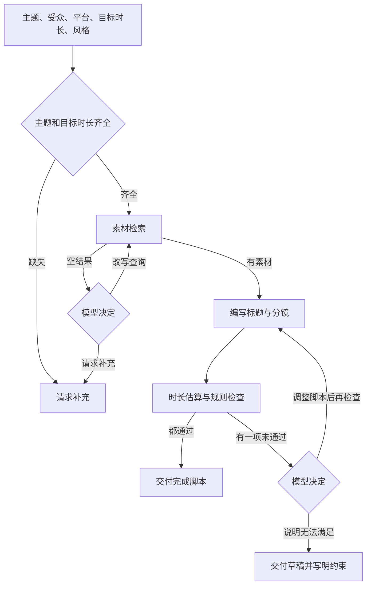

# 需求

本文是当前有效需求。运行方式见 [README.md](../README.md)。实现后的调用流程见 [02-solution.md](02-solution.md)。

## 1. 用户

用户是要产出一条短视频的创作者。创作者提供主题、受众、平台、目标时长和风格。Agent 交回可以逐镜修改的脚本，并标明每条事实的素材来源、预计时长、风险和任务状态。

创作者不负责判断某句卖点是否写在素材里，也不负责口算时长。Agent 负责把依据摊开：哪条素材支持哪一句、估算是多少秒、哪条规则没过、任务停在什么状态。

## 2. 目标

帮助创作者生成有事实依据、满足时长限制的可编辑脚本。一次成功的交付同时包含：

- 标题
- 分镜
- 旁白或字幕
- 预计总时长
- 素材来源 ID
- 风险
- 任务状态

三件事同时成立才算完成：产品事实能回到本轮检索到的素材，预计总时长不超过目标时长，阻断性品牌规则已通过。做不到时，状态和说明写明卡在哪一条。

产品事实来自素材检索。预计时长来自时长估算工具的返回值。能不能发来自规则检查。

## 3. 范围

第一版包含：

- 一次脚本生成所需的主题、受众、平台、目标时长和风格。
- 三类工具：素材检索、时长估算、规则检查。
- 检索为空、时长未通过、规则未通过时，由模型决定下一步。
- 跑一次生成，并把 Trace 写到 `examples/`。
- 五类验收：正常生成、缺关键信息、无素材、工具失败、超时长后的修正或明确失败。

第一版不包含：

- 成片、剪辑、配音、上传和排期发布。
- 投放账户、账号权限和真实商业素材库。
- 用素材片段之外的常识、竞品信息或未给出的数据编写旁白、字幕和标题。
- 在时长或阻断规则尚未通过时使用 `completed`。

## 4. 输入

| 字段 | 是否关键 | 缺失时 |
| --- | --- | --- |
| 主题 | 是 | 状态 `needs_input`，指出缺少主题 |
| 目标时长 | 是 | 状态 `needs_input`，指出缺少目标时长。单位是秒，取正数 |
| 受众 | 否 | 继续生成。交付注明「未指定受众」，并写入风险 |
| 平台 | 否 | 继续生成。时长估算使用工具的通用口播默认值，并写入风险 |
| 风格 | 否 | 继续生成。默认口播：旁白为主，字幕与旁白一致，并写入风险 |

主题和目标时长都有值，才进入检索和写稿。主题宽到无法形成检索查询（例如只说「做一个视频」）时，同样停止并请求补充，状态 `needs_input`。

受众、平台、风格用来决定说法、节奏和主载体。缺了这三项仍可出脚本，交付里写明实际采用的默认值。

风格决定主载体：

- 口播：旁白为主，字幕可与旁白相同。
- 纯字幕：字幕为主，旁白可空。
- 其他风格：旁白和字幕至少一种有正文，并在分镜里写清各自承担的句子。

## 5. 材料

材料是事先提供的产品素材和品牌规则，放在 `data/`。模型只使用工具返回的内容。

当前产品素材是 AdvertiseGen 的属性串，来源 ID 形如 `AG-dev-000533`。可引用正文只有 `body`。同名广告文案在 `reference_summaries.jsonl`，标记为不可引用。验收用的品牌规则在 `data/fixtures/rules-disclaimer.jsonl`，要求声明原文出现。开放素材库没有配套规则集。说明见 [data/README.md](../data/README.md)。

**产品素材。** 每条至少包含稳定唯一的来源 ID，以及可引用的事实描述（功能、规格、适用对象、已核实数据、可用画面说明）。检索返回的片段是写稿时唯一可用的产品事实。

**品牌规则。** 每条至少包含规则 ID、规则内容，以及是否阻断发布。阻断规则不满足时，脚本不能标为完成。非阻断规则未满足时写入风险，仍可完成。

典型阻断内容包括：固定免责声明、禁用的绝对化承诺、未经素材支持的疗效或数据。具体条目以给定规则集为准。

## 6. 工具

工具结果是事实、时长和规则是否通过的依据。模型选择调用时机。工具不改写脚本。

**素材检索。** 输入查询语句。返回来源 ID 和对应片段。空列表表示没有命中，是正常结果。超时、异常和被测试注入的错误才是工具失败。

**时长估算。** 输入各镜的旁白或字幕，以及平台和风格。返回总秒数和逐镜秒数。预计总时长只采用这个返回值，各镜时长之和与总秒数一致。

**规则检查。** 输入标题、分镜、旁白或字幕。返回通过，或违规列表。违规项包含规则 ID、位置、说明、是否阻断。

使用约定：

- 先检索到素材，再写稿，再估算时长和检查规则。
- 同一工具在一轮里失败后自动再试一次。第二次仍失败则停止。
- 检索为空是无素材。工具没有返回结果是工具失败。两条路径的状态不同。
- 来源 ID 必须出现在本轮某次成功的检索结果里。

## 7. 动态决策

模型根据本轮已有结果选择下一步。证据已经够用时就停止。

**检索没有命中时，模型二选一。**

- 改写查询并再次检索。改写使用主题里的产品名、功能或场景。
- 请求创作者补充产品名、素材或更具体的主题。状态为 `needs_input`，说明要补什么。

查询改写最多 2 次（连同最初一次，最多检索 3 次）。次数用尽后仍然为空，状态为 `no_material`。此状态下不编写含产品事实的分镜，来源 ID 为空。

**时长或规则未通过时，模型二选一。**

- 调整脚本后，对未通过的项目再次检查。时长超时则删镜或缩短旁白和字幕。规则未通过则改掉违规措辞，或补上规则要求且素材支持的句子。新增的产品事实仍须带有本轮检索到的来源 ID。
- 说明无法满足。状态为 `unsatisfied`。写明卡住的是时长、哪条阻断规则，或二者冲突；附上最后一次估算秒数和仍在的违规项。

脚本调整最多 2 次。达到上限仍有阻断项或仍超时，状态为 `unsatisfied`。

两项检查都通过，且每条产品事实都能对上来源 ID 时，状态为 `completed`。

工具调用失败时停在失败处理：重试一次仍失败，状态为 `tool_failure`，写明失败的工具名，以及哪一项因此没有完成（素材未核实、时长未估算或规则未检查）。

## 8. 交付

创作者可见的结果只含下列字段。工具调用和模型选择写入 Trace，不混进脚本正文。

| 字段 | 要求 |
| --- | --- |
| 标题 | 一条可修改的标题。 |
| 分镜 | 按播放顺序逐条列出。每条含镜号、画面、旁白或字幕、本镜来源 ID、本镜时长。 |
| 旁白或字幕 | 与风格对应的主载体有正文。产品事实只写检索片段里有的内容。 |
| 预计总时长 | 时长估算工具返回的总秒数，单位秒。 |
| 素材来源 ID | 本条脚本用到的来源 ID 列表，与分镜中的本镜来源 ID 一致。 |
| 风险 | 不阻断发布的事项。没有则为空列表。阻断项留在检查结果中，直到改掉或进入 `unsatisfied`。 |
| 任务状态 | 每轮恰好一个，见下表。 |

| 状态 | 何时使用 |
| --- | --- |
| `completed` | 关键信息齐全，事实有来源，预计总时长不超过目标时长，阻断规则已通过。 |
| `needs_input` | 缺少主题或目标时长，主题无法形成查询，或检索为空且模型决定向创作者要补充信息。 |
| `no_material` | 检索为空，改写查询后仍然没有可用素材，模型结束检索。 |
| `tool_failure` | 检索、时长估算或规则检查失败，重试后仍无结果。 |
| `unsatisfied` | 已调整脚本并再次检查，或模型判断继续改也无法同时满足时长和阻断规则。 |

`completed` 时，预计总时长小于目标时长是允许的，风险中注明「短于目标时长」，方便创作者加镜。超过目标时长时状态不用 `completed`。

`unsatisfied` 和 `tool_failure` 仍交出最后一版草稿、已有的来源 ID、最后一次成功的估算时长，以及未完成的检查项，方便手改。草稿标明当前不能按完成稿使用。

## 9. 成功标准

五类场景全部通过，才算满足本需求。Trace 要能看出模型做了哪一个选择，以及每次工具的输入和返回。

| 场景 | 通过条件 |
| --- | --- |
| 正常生成 | 主题和目标时长齐全，检索有命中，时长不超过目标，阻断规则通过。七项交付齐全。来源 ID 都能在本轮检索结果中找到。状态 `completed`。 |
| 缺关键信息 | 缺少主题或目标时长，或主题无法形成查询。状态 `needs_input`，指出缺的字段。结果不用 `completed`。 |
| 无素材 | 素材库没有与主题相关的条目，检索返回空。模型改写查询再检索，或请求补充。最终状态为 `no_material` 或 `needs_input`。来源 ID 为空。交付中不出现检索结果之外的产品事实。 |
| 工具失败 | 检索、时长估算或规则检查失败，自动重试一次后仍失败。状态 `tool_failure`，写明工具名和未完成的核实项。已成功取回的素材 ID 可以保留。空检索与工具失败使用不同状态。 |
| 超时长后的修正或明确失败 | Trace 中有一次超过目标时长的估算。之后走下面两条路径之一，两条都要能验收。 |

超时长的两条路径：

1. **修正后通过。** 目标时长偏紧，但删镜或缩短文案后可以讲完。再次估算的总时长不超过目标时长，阻断规则仍通过，状态 `completed`。Trace 保留修改前的超时结果和修改后的通过结果。
2. **明确失败。** 目标时长短于必须保留的内容。例如某条阻断规则要求整句出现的声明，单句估算已超过目标时长。状态 `unsatisfied`，写明时长与该规则不能同时满足，并附最后一版草稿和最后一次估算秒数。

预计总时长仍超过目标时，状态保持为 `unsatisfied`。
