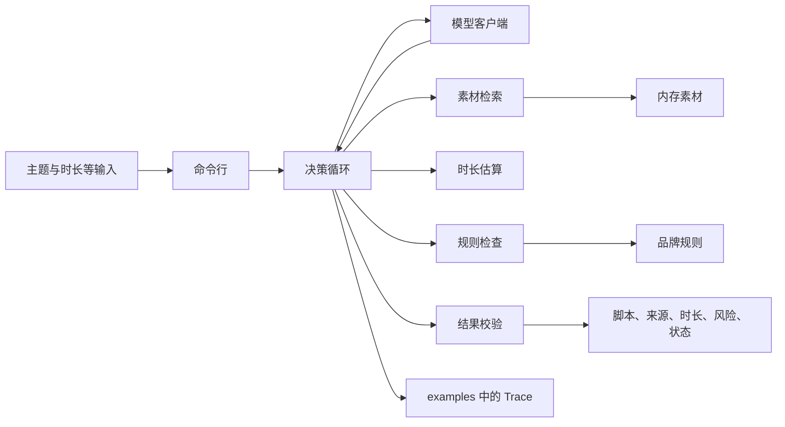

# 方案

本文记录当前代码的调用流程。技术栈和模块边界以 [PRD.md](../PRD.md) 为准，需求以 [01-requirements.md](01-requirements.md) 为准。

## 1. 调用流程

一次生成从 `python -m script_agent.cli` 进入。默认模型是 `ScriptModel`，不访问网络。`--model openai` 才读取 `.env` 里的 `MODEL_BASE_URL`、`MODEL_API_KEY` 和 `MODEL_NAME`。

| 模块 | 做什么 |
| --- | --- |
| `schema.py` | 约束输入、动作、分镜、工具返回、交付和 Trace。 |
| `corpus.py` | 只载入带 `body` 的 JSONL，用汉字二元组和属性值做词法检索。 |
| `rules.py` | 读取品牌规则。`forbid_regex` 在载入时编译，`require_substring` 要求原文出现。 |
| `tools.py` | 检索、估算、规则检查，并在测试注入失败时抛出。 |
| `textutil.py` | 统计可计时字符。估算和剧本模型共用这一处，避免 152 字和 38 秒对不齐。 |
| `policy.py` | 剧本模型的分场景动作。 |
| `model.py` | 剧本模型调用 `policy.py`。真实模型只返回一个 JSON 动作。 |
| `loop.py` | 执行动作，限制次数，失败重试一次，记录 Trace。 |
| `guard.py` | 核对来源、属性值、时长和阻断规则。 |
| `cli.py` | 单次生成，把结果写到 `examples/last-run.json`。 |

广告文案文件没有 `body`。`Corpus.load` 会拒绝它，所以 `reference_summaries.jsonl` 进不了索引。

## 2. 动态决策

循环在调用模型之前处理缺字段和空主题。主题或目标时长缺失，以及主题去掉「视频、短视频、脚本、做一个、生成」后没有剩余内容，直接 `needs_input`，Trace 里没有 `search`。

之后每轮只执行一个动作，最多 12 个。检索最多 3 次。已有草稿后再替换，最多 2 次。同一工具失败后立刻再调用一次，第二次仍失败就 `tool_failure`。

剧本模型的走法：

1. 还没有命中时先按主题检索。结果为空就改写一次查询。改写结果与上一次相同则直接 `no_material`。主题里有「运动鞋」时，第二次查询是「运动鞋」。仍然为空就 `no_material`。
2. 有命中后写第一稿。必须保留的声明单独超过目标时长时，稿件带上该声明和素材里的属性值。主题含「效果」时，第一稿写入「效率提升 80%」。主题含「详细」时，第一稿正好 152 个可计时字符。其余情况写「这个功能」加属性值。
3. 每稿先估算，再做规则检查。出现 `FACT-NUMBER` 就删掉百分数再检查。估算超过目标、且声明本身已经超过目标时，`unsatisfied`。只是稿件偏长时，先改成正好 112 字；112 字仍超时，再改成「这个功能」加属性值。新稿若与当前稿相同，循环直接 `unsatisfied`，不再估算一遍。旁白和字幕全文相同时，同一条数字违规只报告一次。
4. 两项都通过才 `finish` 为 `completed`。

口播 4 字/秒，所以 152 字是 38000 毫秒，112 字是 28000 毫秒。声明去掉标点是 21 字，合 5250 毫秒。目标 4 秒时，保留声明的稿是 6250 毫秒。

`completed` 若缺估算或规则检查，循环先补做。校验失败会把原因交回模型一次。第二次仍失败就改为 `unsatisfied`。剧本验收路径在第一次 `finish` 前已经通过检查，没有走到这次退回。

## 3. 技术取舍

运行时是 Python 3.12。依赖是 `pydantic`、`openai`、`rank-bm25` 和 `pytest`。循环、时长和规则都是自写函数。模型只返回一个 JSON 动作：`search`、`draft`、`estimate`、`check_rules`、`ask`、`finish`。验收走剧本模型，不访问网络。`--model openai` 才读 `.env` 里的三个变量。

没有引入 LangChain、LlamaIndex、jieba、向量库、ffmpeg 或语音合成。属性串很短，11 万条可以一次载入内存。中文按可计时字符的二元组检索，平台不改变语速。

是否命中不看 BM25 分数的正负。只有一条素材时，词出现在全部文档里，BM25 的逆文档频率会变成负数，正分阈值会把 P01 丢掉。现在先要求查询和正文有共同二元组，或查询包含长度不少于 2 的属性值，再用 BM25 给这些候选排序，最多返回 5 条。无关查询仍然返回空列表。

可计时字符只计汉字、英文字母和数字。口播和未识别风格是 4 字/秒，纯字幕是 3.5 字/秒。单镜毫秒是 `round(字符数 × 1000 / 语速)`，总毫秒是各镜之和。152 字因此是 38000 毫秒，112 字是 28000 毫秒。这两个长度只出现在剧本稿里，用来让时长工具复现 38.000 秒和 28.000 秒。字符统计放在 `textutil.py`，估算和写稿共用同一套计数。

`FACT-NUMBER` 始终生效，而且阻断。标题、旁白、字幕里的百分数和「倍」必须出现在已引用的 `body` 里。没有规则文件时，品牌规则为空，这条仍然检查。旁白和字幕全文相同时只查一次，避免同一处数字报两条。

超时后的缩短分三档，避免第二稿和第三稿相同。当前口播长于 112 字时，先收到正好 112 字。112 字仍超过目标，再改成「这个功能」加素材里的属性值。已经是这句最短事实句时，循环直接 `unsatisfied`，不再估算同一稿。必须保留的声明单独超过目标时，不删这句话，状态是 `unsatisfied`。

验收语料用 `data/fixtures/` 的 P01 和声明。开放生成不拿 115669 条逐条当通过条件。`reference_summaries.jsonl` 没有 `body`，载入会被拒绝。
